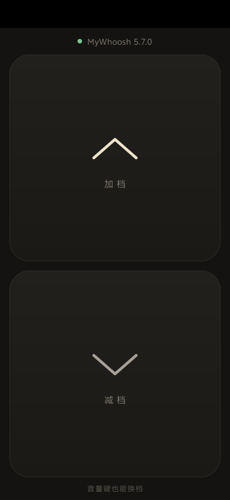

# MyWhoosh Shifter

[中文说明](#中文说明)

Turn an Android phone into a virtual shifter for [MyWhoosh](https://mywhoosh.com)'s MyShift. Two half-screen buttons, and the volume keys shift too — so a cheap Bluetooth selfie shutter strapped to your bars becomes a physical shifter.

It speaks [OpenBikeControl](https://github.com/OpenBikeControl/openbikecontrol-protocol) over Wi-Fi (mDNS + TCP), which MyWhoosh supports natively. No account, no pairing code, no cloud.

> Not affiliated with MyWhoosh. If you just want shifting from your phone, the official MyWhoosh Link app does that too. This project is for people who want something small enough to read and modify.

## Install

1. Download the APK from [Releases](../../releases) and install it (Android 8+).
2. Put the phone on the **same Wi-Fi** as the device running MyWhoosh.
3. Open the app and keep it in the foreground. In MyWhoosh, go to the device connection screen (where you pair your trainer and heart rate monitor). Of the four icons in the top-right corner (LAN, Link, BLE and an unlabeled handlebar), tap the **handlebar**. It connects right away. The device list won't show the phone, at most a line saying "OpenBikeControl Instance Found".
4. The status line at the top turns green and shows the MyWhoosh version once connected.

Tested with MyWhoosh 5.7.0 on iPad.

**Compatibility:** any trainer that works with MyShift in MyWhoosh — the app only talks to MyWhoosh, never to the trainer. The numbers below were measured on a Magene GEOID VE300; the −2% down-shift floor may differ on other trainers.

## MyWhoosh settings

Turn **MyShift** on. Then in **Settings → Equipment**:

- **Gear step size** sets how big each shift is. Lower = finer.

  | Gear step size | Grade per gear | ≈ watts per gear (flat, 25 km/h) | Gears below start on a flat road |
  |---|---|---|---|
  | 16 | 0.63% | ~32 W | 4 |
  | 32 | 0.79% | ~40 W | 3 |
  | 50 | 1.01% | ~51 W | — |
  | 64 | 1.23% | ~63 W | 2 |

  Watts are a rough estimate for 75 kg rider + bike, for comparison only.

  **Start with 32.** If each shift feels too big, go lower — but even 16 only takes you from 0.8% to 0.6% per gear. Go higher for bigger jumps.
- **Gradient** (gradient feel) only scales the *road's* grade. It does **not** change the size of a shift — at Gradient 100 and 50 with step 32, each gear added exactly the same amount.

How it behaves (measured by listening to what MyWhoosh sends the trainer):

- MyShift has 30 gears and every ride starts in gear 15, which equals the road grade × Gradient %.
- Each shift adds or removes a fixed amount on top. Steps are not perfectly even (0.73–0.88% at step 32), but they repeat exactly, with the same up-and-down pattern at every step size — the slider seems to scale one fixed gear table.
- **Shifting down bottoms out at about −2% grade.** On flat roads that's only ~3 gears below the start. Extra down-shifts past that are still counted, so you'll need the same number of up-shifts before you feel anything again.

If your trainer came with its **own shift remote**, don't use it together with this. Those usually change the trainer's internal gear table directly, which MyWhoosh never sees, so the two systems fight each other.

## Hack on it

The whole app is two files:

- [`ObcServer.kt`](app/src/main/java/io/github/hannahinthere/mywhooshshifter/ObcServer.kt): ~180 lines. Advertises `_openbikecontrol._tcp` over mDNS, accepts MyWhoosh's TCP connection, sends button presses, receives haptics.
- [`MainActivity.kt`](app/src/main/java/io/github/hannahinthere/mywhooshshifter/MainActivity.kt): the UI.

The protocol is tiny: shift up is `[0x01, 0x01, 0x01]` (press) then `[0x01, 0x01, 0x00]` (release); shift down uses button `0x02`. See the [protocol spec](https://github.com/OpenBikeControl/openbikecontrol-protocol/blob/main/PROTOCOL.md) for everything else (direct gear select, steering, braking…).

Ideas:

- **Mac / PC**: the same ~50 lines in Python with `zeroconf` and `asyncio` work fine — bind any key to shift.
- **ESP32 firmware**: two buttons + the OpenBikeControl [BLE transport](https://github.com/OpenBikeControl/openbikecontrol-protocol/blob/main/BLE.md) and you have a real bar-mounted shifter, no phone needed.
- **Your own app**: drop `ObcServer.kt` in and call `press(ObcServer.UP)`.

Build: `./gradlew assembleDebug`.

## License

MIT

---

## 中文说明

把安卓手机变成 MyWhoosh 的 MyShift 虚拟变速换档器。两颗半屏大按钮，音量键也能换档，所以买个蓝牙自拍快门绑在车把上，就是一个实体换档器。

走的是 MyWhoosh 原生支持的 [OpenBikeControl](https://github.com/OpenBikeControl/openbikecontrol-protocol) 协议（Wi-Fi，mDNS + TCP），不用账号，不用配对码，不走云端。

> 和 MyWhoosh 官方无关。只想用手机换档的话，官方的 MyWhoosh Link 也能做到；这个项目是给想自己改的人准备的，代码小到一眼看完。

### 安装

1. 在 [Releases](../../releases) 下载 APK 安装（安卓 8 以上）。
2. 手机和跑 MyWhoosh 的设备连**同一个 Wi-Fi**。
3. 打开 app 并保持在前台。在 MyWhoosh 的设备连接页（就是连骑行台、心率带的那页），右上角有四个图标：LAN、Link、BLE，最后一个没有文字、是个**车把**图标，点它就直接连上了。设备列表里不会出现手机，最多显示一行「OpenBikeControl Instance Found」。
4. 连上后顶部状态变绿，显示 MyWhoosh 版本号。

在 iPad 上的 MyWhoosh 5.7.0 测试过。

**兼容性：** 任何能在 MyWhoosh 里用 MyShift 的骑行台都行，app 只跟 MyWhoosh 通信。下面的数据是在迈金 GEOID VE300 上测的，-2% 的减档下限换了骑行台可能不同。

### MyWhoosh 设置

打开 **MyShift**，然后在 **Settings → Equipment** 里：

- **Gear step size** 决定每档跨多大，越小越细。

  | Gear step size | 每档坡度差 | 平路 25km/h 粗算一档 | 平路开局往下能减几档 |
  |---|---|---|---|
  | 16 | 0.63% | ~32W | 4 档 |
  | 32 | 0.79% | ~40W | 3 档 |
  | 50 | 1.01% | ~51W | — |
  | 64 | 1.23% | ~63W | 2 档 |

  功率按人加车 75kg 粗算，只用来对比，不是精确值。

  **默认先用 32。** 每档太跳就往小调，但调到 16 也只是从每档 0.8% 变成 0.6%；想要大跨度就往大调。
- **Gradient** 只给**路面坡度**打折，**不影响每档的大小**。step 32 下，Gradient 100 和 50 每档加的量完全一样。

实测行为（监听 MyWhoosh 发给骑行台的指令得出）：

- MyShift 共 30 档，每次开骑在第 15 档，这一档等于「路面坡度 × Gradient%」。
- 每换一档在此基础上加减固定的量。档距不完全均匀（step 32 时 0.73%~0.88%），但每次都一样，而且不同 step 下起伏形状相同，像是拉杆在整体缩放一张固定的档位表。
- **减档到大约 −2% 坡度就到底了**，平路上从开局往下只有 3 档左右。到底后多按的减档仍然会被记住，要按同样次数的加档才会重新有感觉。

如果骑行台**自带换档遥控器**，别和这个混用。那类遥控器通常直接改骑行台自己的齿比表，MyWhoosh 不知道，两套系统会互相打架。

### 自己改

整个 app 就两个文件：`ObcServer.kt`（约 180 行，mDNS 广播、接受 MyWhoosh 的 TCP 连接、发按键、收振动）和 `MainActivity.kt`（界面）。协议很简单：加档发 `[0x01, 0x01, 0x01]` 按下、`[0x01, 0x01, 0x00]` 松开，减档按键号是 `0x02`。其他功能（直接选档、转向、刹车……）见[协议文档](https://github.com/OpenBikeControl/openbikecontrol-protocol/blob/main/PROTOCOL.md)。

- **Mac / PC**：用 Python 的 `zeroconf` + `asyncio` 写五十来行就能跑，绑任意按键。
- **ESP32 固件**：两个按键 + OpenBikeControl 的[蓝牙版本](https://github.com/OpenBikeControl/openbikecontrol-protocol/blob/main/BLE.md)，就是一个不用手机的车把换档器。
- **塞进自己的 app**：把 `ObcServer.kt` 拷进去，调 `press(ObcServer.UP)`。

编译：`./gradlew assembleDebug`。
